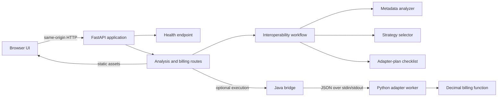

# Cross-Language Package Interoperability Agent

A small, runnable workbench for exploring interoperability between packages
written in different programming languages. Enter package metadata in the web
interface or call the API to receive an export-name analysis, a recommended
integration strategy, and a checklist-style adapter plan. An optional billing
demo exercises a real Java-to-Python process boundary.

## Problem and objectives

Packages implemented in different languages cannot be integrated safely by
comparing names alone. Teams need to identify likely integration risks, choose
a language-neutral boundary when appropriate, and specify what an adapter and
its tests still need to cover.

This project demonstrates that workflow while keeping its claims deliberately
bounded:

- Validate package metadata and surface known export-name mismatches.
- Recommend a strategy based on the declared language labels.
- Present implementation and test steps for a human to carry out.
- Demonstrate a JSON request/response boundary and a Java-launched Python
  billing worker.

The analyzer does **not** inspect arbitrary package source code, compare
function signatures or runtime behavior, prove compatibility, or generate a
production adapter. The adapter plan is guidance, not generated integration
code.

## Features

- Responsive browser interface served by the FastAPI application.
- Input validation for package names, languages, exports, and billing values.
- Conservative export-name analysis with explicit compatibility caveats.
- Deterministic `direct_import` or `rest_api` strategy recommendations.
- Adapter implementation and test checklists.
- JSON request adapter with input and result validation.
- Optional Java bridge that launches the active Python interpreter.
- Billing arithmetic using Python `Decimal`.
- Health endpoint and automatically generated OpenAPI/Swagger documentation.

## Architecture



The analyzer, strategy selector, and plan builder operate on the submitted
metadata only. Runtime execution is separate: the billing route starts Java,
which starts the Python worker and relays one JSON request and response.

## Technology stack

- Python 3.10+ and Pydantic 2 for models and request validation.
- FastAPI and Uvicorn for HTTP routes, static-file serving, and OpenAPI docs.
- Standard-library HTML, CSS, and JavaScript for the frontend (no Node build
  step or frontend package manager is required).
- Java JDK for compiling and running the process bridge.
- Pytest and FastAPI's test client for automated tests.

## Repository structure

```text
app/
  agents/          Analyzer, strategy selector, adapter-plan builder
  api/routes/      FastAPI request models and endpoints
  controllers/     Analysis request controller
  integrations/    JSON adapter, billing worker, and Java bridge
  services/        Interoperability workflow orchestration
  main.py          FastAPI app, health route, and frontend serving
frontend/          Browser interface (HTML, CSS, JavaScript)
tests/             Unit, API, and Java bridge integration tests
docs/              Demonstration and presentation guide
requirements.txt   Python runtime and test dependencies
```

## Requirements

- Windows 10/11 and Python 3.10 or later. The documented setup uses Python 3.12.
- A Java Development Kit (JDK) available on `PATH` or through `JAVA_HOME` for
  billing execution. JDK 11 or later is recommended. The bridge compiles
  `BillingBridge.java` on demand when its ignored `.class` file is missing or
  older than the source.
- Git is needed to clone the repository. Node.js is not needed to run or build
  the frontend.

## Setup and run on Windows

Clone the repository and open its root directory in PowerShell:

```powershell
git clone https://github.com/Mehret-araya/cross-language-agent.git
Set-Location cross-language-agent
```

Create a virtual environment and install the declared dependencies:

```powershell
py -3.12 -m venv .venv
.\.venv\Scripts\python.exe -m pip install -r requirements.txt
```

Confirm the JDK commands are available:

```powershell
java -version
javac -version
```

If needed, set `JAVA_HOME` to your installed JDK directory (replace the example
path with the actual installation directory) and add its `bin` directory to
`PATH`:

```powershell
$env:JAVA_HOME = "C:\Program Files\Eclipse Adoptium\jdk-21"
$env:Path = "$env:JAVA_HOME\bin;$env:Path"
```

Start the application from the repository root:

```powershell
.\.venv\Scripts\python.exe -m uvicorn app.main:app --reload
```

Open these local URLs while the server is running:

- Frontend: <http://127.0.0.1:8000/>
- Health: <http://127.0.0.1:8000/health>
- Swagger UI: <http://127.0.0.1:8000/docs>
- OpenAPI JSON: <http://127.0.0.1:8000/openapi.json>

The browser UI uses the same origin for its API requests. It submits package
metadata to `POST /analyze-with-execution`. When the optional billing switch is
enabled, it also submits the entered billing values to
`POST /execute-billing-example`.

## API

### `POST /analyze`

Validates the package metadata and returns the package analysis, recommended
strategy, and adapter plan.

```json
{
  "source": {
    "name": "billing-python",
    "language": "Python",
    "version": "1.0",
    "runtime": "Python 3.12",
    "exports": ["calculate_total"]
  },
  "target": {
    "name": "billing-java",
    "language": "Java",
    "version": "1.0",
    "runtime": "JVM",
    "exports": ["calculateTotal"]
  }
}
```

Response shape (lists abbreviated):

```json
{
  "analysis": {
    "compatible": false,
    "risks": [
      "Cross-language boundary needs an interoperability strategy.",
      "No matching export names found; map the APIs explicitly."
    ],
    "evidence": [
      "Source: billing-python (Python)",
      "Target: billing-java (Java)"
    ],
    "recommended_next_step": "Inspect APIs and choose an adapter strategy."
  },
  "strategy": {
    "name": "rest_api",
    "reason": "A language-neutral HTTP interface can connect packages written in different languages.",
    "next_steps": ["Define request and response schemas."]
  },
  "adapter_plan": {
    "source_package": "billing-python",
    "target_package": "billing-java",
    "strategy": "rest_api",
    "steps": ["Inspect the public API and define an interface."],
    "test_requirements": ["Test successful calls and error handling."]
  }
}
```

`source` and `target` require a non-blank `name` and `language`. They accept
optional `version` and `runtime` strings and up to 100 `exports`; export names
must not be blank. Extra fields are rejected. The strategy selector compares
trimmed, case-insensitive language labels: equal labels produce `direct_import`,
otherwise it produces `rest_api`. It does not inspect installed packages or
versions.

The analyzer compares trimmed export names and reports shared names as evidence,
but also adds a risk stating that matching names do not prove compatibility.
Unmatched exports are flagged for explicit mapping. Consequently, this
metadata-only MVP does not certify a package pair as compatible; its boolean is
a conservative signal, not a proof of runtime behavior. The adapter plan is a
static checklist, not generated adapter code.

### `POST /analyze-with-execution`

Accepts the same `source` and `target` objects plus optional
`"execute_example": true`. If true, the API runs a **fixed** demonstration
request (`unit_price` `"20.00"`, `quantity` `3`) through the Java bridge and
adds `execution_example` to the analysis response. The web interface instead
calls the billing endpoint separately so that it can use the values entered in
the billing form.

The optional execution response shape is:

```json
{
  "execution_example": {
    "ok": true,
    "result": {
      "unit_price": "20.00",
      "quantity": 3,
      "total": "60.00"
    }
  }
}
```

### `POST /execute-billing-example`

Runs billing through the Java bridge. `unit_price` must be a non-negative finite
decimal string and `quantity` must be a non-negative integer.

```json
{
  "unit_price": "20.00",
  "quantity": 3
}
```

Successful response:

```json
{
  "ok": true,
  "result": {
    "unit_price": "20.00",
    "quantity": 3,
    "total": "60.00"
  }
}
```

The Java process relays JSON to the Python worker over standard input/output;
the worker calls the billing function. `Decimal` is used for arithmetic and the
result is not coerced to binary floating point or automatically quantized to a
currency scale.

### Validation and errors

- Invalid request bodies, extra fields, blank required metadata, invalid prices,
  booleans/non-integer quantities, and negative quantities return HTTP 422.
- Missing Java runtime/compiler returns HTTP 503.
- Java bridge execution or compilation timeouts return HTTP 504.
- Other bridge failures (including worker errors) return HTTP 502.

Gateway errors use FastAPI's JSON detail shape, for example:

```json
{
  "detail": "Java runtime was not found. Install a JDK and add java to PATH or set JAVA_HOME."
}
```

### `GET /health`

Returns `{"status": "ok"}` when the API process is responsive. This does not
probe Java availability.

## Tests

Run the complete Python test suite:

```powershell
.\.venv\Scripts\python.exe -m pytest
```

The suite covers validation, analysis, strategy selection, adapter planning,
JSON handling, billing arithmetic and errors, API routes, and the Java-to-Python
execution bridge. The frontend is plain JavaScript; check its syntax with:

```powershell
node --check frontend\app.js
```

## Security considerations

This is a local demonstration, not a hardened public service. The API has no
authentication, authorization, rate limiting, or deployment security
configuration. Billing execution starts local Java and Python processes; do not
expose it to untrusted callers without adding access controls, resource limits,
and process isolation. User-supplied package names and exports are treated as
metadata only: the application does not install or execute submitted packages.

## Known limitations and future improvements

- Analysis is based only on package names, language labels, and declared export
  names; it does not inspect signatures, types, dependencies, or behavior.
- Strategy selection is intentionally limited to `direct_import` and
  `rest_api`; it does not assess deployment environment or performance.
- The adapter planner returns generic steps and test requirements, not code.
- The Java/Python example is a local process bridge, not a deployed REST adapter.
- The frontend has no separate production bundler or automated browser-test
  harness.

Potential next steps include richer package metadata, signature/type comparison,
additional strategy rules, generated adapter scaffolding, API authentication,
process isolation, and browser-level automated tests.
