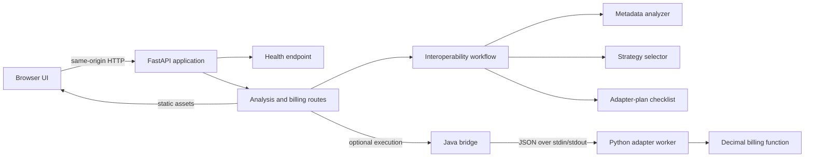

# Cross-Language Package Interoperability Agent

A small, runnable workbench for exploring interoperability between packages
written in different programming languages. Enter package metadata in the web
interface or call the API to receive an export-name analysis, a recommended
integration strategy, and a checklist-style adapter plan. An optional billing
demo exercises a real Java-to-Python process boundary.

## Problem and objectives

Packages implemented in different languages cannot be integrated safely by
comparing names alone. Teams need to identify likely integration risks, choose
a language-neutral boundary when appropriate, and specify what an adapter and
its tests still need to cover.

This project demonstrates that workflow while keeping its claims deliberately
bounded:

- Validate package metadata and surface known export-name mismatches.
- Recommend a strategy based on the declared language labels.
- Present implementation and test steps for a human to carry out.
- Demonstrate a JSON request/response boundary and a Java-launched Python
  billing worker.

The analyzer does **not** inspect arbitrary package source code, compare
function signatures or runtime behavior, prove compatibility, or generate a
production adapter. The adapter plan is guidance, not generated integration
code.

## Features

- Responsive browser interface served by the FastAPI application.
- Input validation for package names, languages, exports, and billing values.
- Conservative export-name analysis with explicit compatibility caveats.
- Deterministic `direct_import` or `rest_api` strategy recommendations.
- Adapter implementation and test checklists.
- JSON request adapter with input and result validation.
- Optional Java bridge that launches the active Python interpreter.
- Billing arithmetic using Python `Decimal`.
- Health endpoint and automatically generated OpenAPI/Swagger documentation.

## Architecture



The analyzer, strategy selector, and plan builder operate on the submitted
metadata only. Runtime execution is separate: the billing route starts Java,
which starts the Python worker and relays one JSON request and response.

## Technology stack

- Python 3.10+ and Pydantic 2 for models and request validation.
- FastAPI and Uvicorn for HTTP routes, static-file serving, and OpenAPI docs.
- Standard-library HTML, CSS, and JavaScript for the frontend (no Node build
  step or frontend package manager is required).
- Java JDK for compiling and running the process bridge.
- Pytest and FastAPI's test client for automated tests.

## Repository structure

```text
app/
  agents/          Analyzer, strategy selector, adapter-plan builder
  api/routes/      FastAPI request models and endpoints
  controllers/     Analysis request controller
  integrations/    JSON adapter, billing worker, and Java bridge
  services/        Interoperability workflow orchestration
  main.py          FastAPI app, health route, and frontend serving
frontend/          Browser interface (HTML, CSS, JavaScript)
tests/             Unit, API, and Java bridge integration tests
docs/              Demonstration and presentation guide
requirements.txt   Python runtime and test dependencies
```

## Requirements

- Python 3.10 or later
- A Java Development Kit (JDK) on `PATH` or available through `JAVA_HOME` to use
  the billing execution endpoints. The Java bridge compiles its source on demand
  when the `.class` file is absent or out of date.

## Setup and run on Windows

From the repository root in PowerShell:

```powershell
py -3.12 -m venv .venv
.\.venv\Scripts\python.exe -m pip install -r requirements.txt
```

If Java is not already on `PATH`, set `JAVA_HOME` to your JDK directory and add
its `bin` directory to `PATH`:

```powershell
$env:JAVA_HOME = "C:\Program Files\Eclipse Adoptium\jdk-21"
$env:Path = "$env:JAVA_HOME\bin;$env:Path"
```

Start the API:

```powershell
.\.venv\Scripts\python.exe -m uvicorn app.main:app --reload
```

The web interface and service are available at `http://127.0.0.1:8000`.
Interactive API documentation is at `http://127.0.0.1:8000/docs`; the health
endpoint is `GET /health`.

The interface submits package analysis to `POST /analyze-with-execution` and,
when requested, billing inputs to `POST /execute-billing-example`. Both API
calls use the same origin as the UI.

## API

### `POST /analyze`

Validates the package metadata and returns the package analysis, recommended
strategy, and adapter plan.

```json
{
  "source": {
    "name": "billing-python",
    "language": "Python",
    "version": "1.0",
    "runtime": "Python 3.12",
    "exports": ["calculate_total"]
  },
  "target": {
    "name": "billing-java",
    "language": "Java",
    "version": "1.0",
    "runtime": "JVM",
    "exports": ["calculateTotal"]
  }
}
```

Names and languages must be non-empty. Export entries cannot be blank; unknown
fields are rejected. Shared export names are evidence only and do not establish
API compatibility.

### `POST /analyze-with-execution`

Accepts the same `source` and `target` objects, plus an optional
`"execute_example": true`. The optional example runs the fixed billing request
through the Java bridge and includes its result as `execution_example`.

### `POST /execute-billing-example`

Runs billing through the Java bridge. `unit_price` must be a non-negative finite
decimal string and `quantity` must be a non-negative integer.

```json
{
  "unit_price": "20.00",
  "quantity": 3
}
```

Request validation errors return HTTP 422. Java toolchain issues return HTTP 503,
bridge timeouts return HTTP 504, and other bridge failures return HTTP 502.
Billing uses Python `Decimal` arithmetic and returns the submitted price,
quantity, and calculated total.

### `GET /health`

Returns `{"status": "ok"}` when the API process is responsive. This does not
probe Java availability.

## Tests

Run the complete test suite:

```powershell
.\.venv\Scripts\python.exe -m pytest
```

The suite covers validation, analysis, strategy selection, adapter planning,
JSON handling, billing arithmetic and errors, API routes, and the Java-to-Python
execution bridge.
